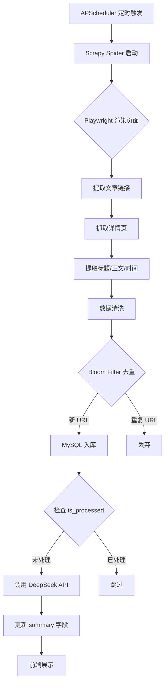

# GFNA 系统架构文档

> **文档版本**: V1.0
> **编写日期**: 2025-06-14
> **适用项目**: 全球财经新闻聚合器 (Global Finance News Aggregator)

---

## 一、技术选型论证

### 1.1 后端框架: FastAPI (选择理由)

| 对比维度 | FastAPI | Flask | Django |
|----------|---------|-------|--------|
| 异步支持 | ✅ 原生 async/await | ❌ 需扩展 | ⚠️ 3.1+ 支持 |
| 自动 API 文档 | ✅ Swagger UI 自动生成 | ❌ 需插件 | ❌ 需插件 |
| 数据校验 | ✅ Pydantic 集成 | ❌ 手动校验 | ⚠️ DRF |
| 性能 | ⭐⭐⭐⭐⭐ | ⭐⭐⭐ | ⭐⭐⭐ |
| 学习曲线 | ⭐⭐⭐ | ⭐⭐⭐⭐⭐ | ⭐⭐ |

**选择理由**: FastAPI 原生异步支持适合爬虫+I/O 密集型场景；自动生成的 Swagger 文档方便课程答辩展示。

### 1.2 数据库: MySQL 8.0 (选择理由)

选择 MySQL 而非 PostgreSQL 的原因：
- **课程要求**: 数据库原理课程以 MySQL 为主要教学数据库
- **普及度**: MySQL 是学生最容易获取和部署的数据库
- **全文检索**: MySQL 8.0 的 FULLTEXT 索引支持中英文混合搜索
- **字符集**: utf8mb4 完全支持中文和多语言存储

### 1.3 AI 模型: DeepSeek API (选择理由)

| 对比维度 | DeepSeek | Claude API | OpenAI GPT |
|----------|----------|------------|------------|
| 中文质量 | ⭐⭐⭐⭐⭐ | ⭐⭐⭐⭐ | ⭐⭐⭐⭐ |
| 价格 | 💰 极低 | 💰💰💰 中等 | 💰💰💰💰 较高 |
| 兼容性 | OpenAI SDK 兼容 | Anthropic SDK | OpenAI SDK |
| 国内访问 | ✅ 直连 | ⚠️ 需代理 | ⚠️ 需代理 |

**选择理由**: DeepSeek 中文效果好、价格低、API 与 OpenAI 完全兼容，且国内可直接访问。

### 1.4 ORM: SQLAlchemy 2.0

选择 ORM 而非原生 SQL 的原因：
- **防注入**: 参数化查询自动防止 SQL 注入
- **可维护性**: 模型定义即文档，便于课程答辩展示
- **迁移便利**: 切换数据库只需改连接串，代码不用动

---

## 二、系统架构图

### 2.1 整体架构

```
┌─────────────────────────────────────────────────────────┐
│                      用户浏览器                          │
│              http://localhost:8000                       │
└─────────────────────┬───────────────────────────────────┘
                      │
                      ▼
┌─────────────────────────────────────────────────────────┐
│                  FastAPI 后端服务                         │
│  ┌──────────────┐  ┌──────────────┐  ┌──────────────┐  │
│  │  路由层 (API) │  │  服务层       │  │  数据层 (ORM) │  │
│  │              │  │              │  │              │  │
│  │ /articles    │  │ llm_service  │  │ SQLAlchemy   │  │
│  │ /search      │  │ crawler_svc  │  │ Models       │  │
│  │ /stats       │  │              │  │              │  │
│  └──────────────┘  └──────┬───────┘  └──────┬───────┘  │
│                           │                  │          │
└───────────────────────────┼──────────────────┼──────────┘
                            │                  │
              ┌─────────────┼──────┐    ┌──────▼──────────┐
              │             │      │    │  MySQL 8.0      │
              │  DeepSeek   │      │    │  gfna_db        │
              │  API        │◄─────┘    └─────────────────┘
              │  (云服务)    │
              └─────────────┘
                            │
┌─────────────────────────────────────────────────────────┐
│                   Scrapy 爬虫系统                         │
│  ┌──────────────┐  ┌──────────────┐  ┌──────────────┐  │
│  │  Spiders     │  │  Middlewares  │  │  Pipelines   │  │
│  │  (爬取逻辑)   │  │  (UA轮换)     │  │  (去重+入库)  │  │
│  └──────┬───────┘  └──────────────┘  └──────┬───────┘  │
│         │                                    │          │
│         │  ┌──────────────────┐             │          │
│         └──│  Playwright      │◄────────────┘          │
│            │  (JS 页面渲染)    │                         │
│            └──────────────────┘                         │
└─────────────────────────────────────────────────────────┘
                            │
                            ▼
              ┌─────────────────────────┐
              │  Reuters / Bloomberg    │
              │  CNBC / MarketWatch     │
              │  (目标新闻网站)          │
              └─────────────────────────┘
```

### 2.2 数据流程



---

## 三、数据库设计详解

### 3.1 ER 图 (实体关系)

```
┌──────────────────────┐
│    news_sources      │
├──────────────────────┤
│ PK │ id              │──────────┐
│    │ name (UNIQUE)   │          │ 1
│    │ base_url        │          │
│    │ country         │          │
│    │ language        │          │
│    │ is_active       │          │
│    │ crawl_interval  │          │
│    │ created_at      │          │
│    │ updated_at      │          │
└──────────────────────┘          │
                                  │ 拥有
                                  │
                                  ▼ N
                        ┌──────────────────────┐
                        │   news_articles      │
                        ├──────────────────────┤
                        │ PK │ id              │
                        │ FK │ source_id       │
                        │    │ title           │
                        │    │ url             │
                        │ UK │ url_hash        │ ← 去重核心
                        │    │ content (TEXT)  │
                        │    │ summary (TEXT)  │ ← AI 摘要
                        │    │ author          │
                        │    │ publish_time    │
                        │    │ crawl_time      │
                        │    │ sentiment_score │ ← 预留
                        │    │ is_processed    │
                        │    │ created_at      │
                        └──────────────────────┘
                                  │
                                  │ 记录
                                  ▼
                        ┌──────────────────────┐
                        │    crawl_logs        │
                        ├──────────────────────┤
                        │ PK │ id              │
                        │ FK │ source_id       │
                        │    │ status          │
                        │    │ articles_found  │
                        │    │ articles_new    │
                        │    │ error_message   │
                        │    │ started_at      │
                        │    │ finished_at     │
                        └──────────────────────┘
```

### 3.2 去重机制原理

```
新URL到来
    │
    ▼
┌─────────────────────┐
│ 1. 计算 SHA-256 哈希  │   url → hashlib.sha256() → 64位十六进制
└─────────┬───────────┘
          │
          ▼
┌─────────────────────┐
│ 2. Bloom Filter 检查 │   快速判断 (内存操作, O(1))
│   可能存在?          │
└─────────┬───────────┘
          │
    ┌─────┴─────┐
    │ 否        │ 是 (可能误判)
    ▼           ▼
┌─────────┐  ┌─────────────────────┐
│ 直接入库 │  │ 3. MySQL UNIQUE 检查  │  精确判断 (磁盘操作)
└─────────┘  │   url_hash 唯一索引   │
             └─────────┬───────────┘
                       │
                 ┌─────┴─────┐
                 │ 不存在     │ 已存在
                 ▼           ▼
            ┌─────────┐  ┌─────────┐
            │ 写入成功 │  │ 跳过    │
            └─────────┘  └─────────┘
```

**为什么需要两层?**
- Bloom Filter 在内存中运行，速度快，能过滤掉 99.9% 的重复请求
- MySQL UNIQUE 索引是最后防线，防止布隆过滤器的误判导致重复数据

---

## 四、AI 摘要流程

```
文章正文 (英文HTML)
    │
    ▼
┌───────────────────┐
│ HTML 清洗          │  re.sub() 去除标签/脚本/样式
│ 提取纯文本         │
└─────────┬─────────┘
          │
          ▼
┌───────────────────┐
│ 长度检查           │  < 50 字符 → 跳过
│                   │  > 10000 字符 → 截断
└─────────┬─────────┘
          │
          ▼
┌───────────────────┐
│ System Prompt:     │  "你是专业的财经新闻编辑..."
│ User Prompt:       │  "请将以下财经新闻总结为中文..."
│ Max Tokens: 300    │
│ Temperature: 0.3   │
└─────────┬─────────┘
          │
          ▼
┌───────────────────┐
│ DeepSeek API       │  POST https://api.deepseek.com/v1/chat/completions
│ Model: deepseek-chat│
└─────────┬─────────┘
          │
    ┌─────┴─────┐
    │ 成功       │ 失败
    ▼           ▼
┌─────────┐  ┌───────────────────┐
│ 返回摘要 │  │ 重试 (最多3次)      │
│ 写入DB  │  │ 指数退避: 2s,4s,8s │
└─────────┘  │ 全失败 → 标记失败   │
             └───────────────────┘
```

---

## 五、安全设计

| 安全措施 | 实现方式 |
|----------|----------|
| **SQL 注入防护** | SQLAlchemy ORM 参数化查询 (禁止字符串拼接 SQL) |
| **API Key 保护** | 管理员接口需要 `X-API-Key` 请求头验证 |
| **敏感信息隔离** | API Key / 数据库密码存放在 `.env`，已加入 `.gitignore` |
| **XSS 防护** | 前端使用 `escapeHtml()` 函数转义所有用户可见文本 |
| **速率限制** | API 接口配置限流 (默认 60次/分钟) |
| **版权合规** | 所有新闻内容保留原始来源链接 |

---

## 六、部署架构

```
┌──────────────────────────────────────────┐
│              服务器 (Linux)               │
│                                          │
│  ┌────────────────────────────────────┐ │
│  │  Uvicorn (ASGI Server)             │ │
│  │  - 端口: 8000                       │ │
│  │  - Workers: 1 (开发)/ 4 (生产)      │ │
│  │  - 热重载: 开发模式开启              │ │
│  └──────────────┬─────────────────────┘ │
│                 │                        │
│  ┌──────────────▼─────────────────────┐ │
│  │  FastAPI 应用                       │ │
│  │  - CORS: 允许所有来源 (开发)        │ │
│  │  - 静态文件: frontend/ 目录         │ │
│  └──────────────┬─────────────────────┘ │
│                 │                        │
│  ┌──────────────▼─────────────────────┐ │
│  │  APScheduler (后台线程)             │ │
│  │  - 爬虫任务: 每60分钟               │ │
│  │  - 摘要任务: 每60分钟               │ │
│  └────────────────────────────────────┘ │
│                                          │
│  ┌────────────────────────────────────┐ │
│  │  MySQL 8.0 (Docker 容器)            │ │
│  │  - 端口: 3306                       │ │
│  │  - 连接池: 10                       │ │
│  │  - 字符集: utf8mb4                  │ │
│  └────────────────────────────────────┘ │
│                                          │
└──────────────────────────────────────────┘
```

---

## 七、未来优化方向

- [ ] **情感分析**: 对新闻进行正负面情感打分 (sentiment_score 字段已预留)
- [ ] **主题分类**: 使用 NLP 模型将新闻分类 (宏观经济/股票/外汇/大宗商品)
- [ ] **用户系统**: 支持注册/登录/收藏
- [ ] **数据导出**: 支持导出 CSV/PDF 报告
- [ ] **代理池**: 爬虫支持 IP 代理轮换，提高抓取成功率
- [ ] **可视化**: 财经数据趋势图表 (ECharts/D3.js)

---

> **文档结束** | GFNA 系统架构文档 V1.0